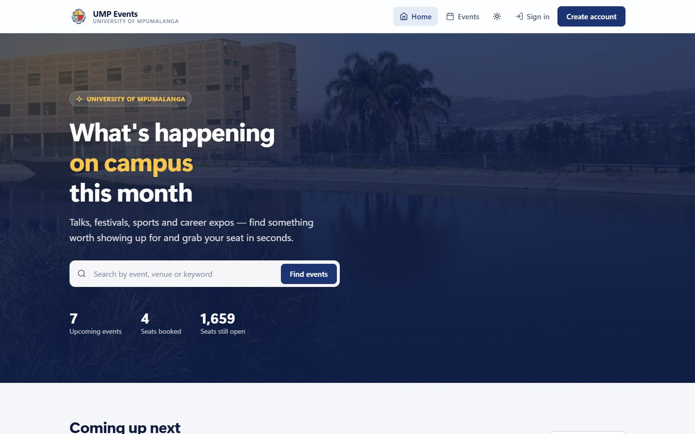
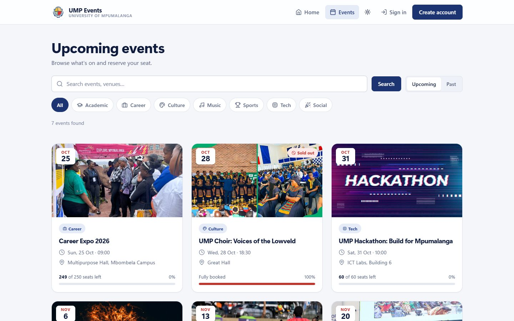
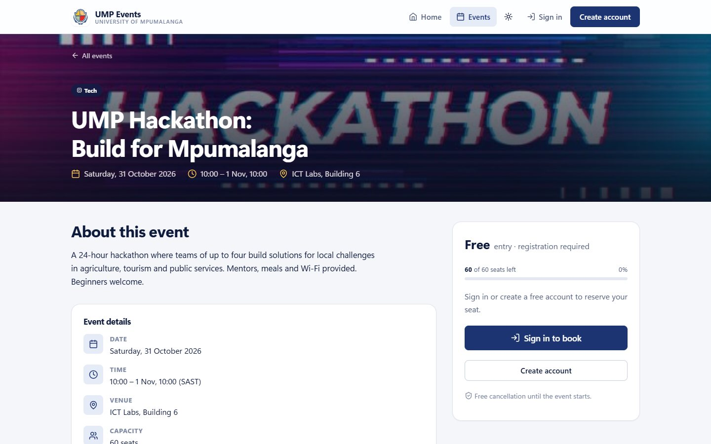
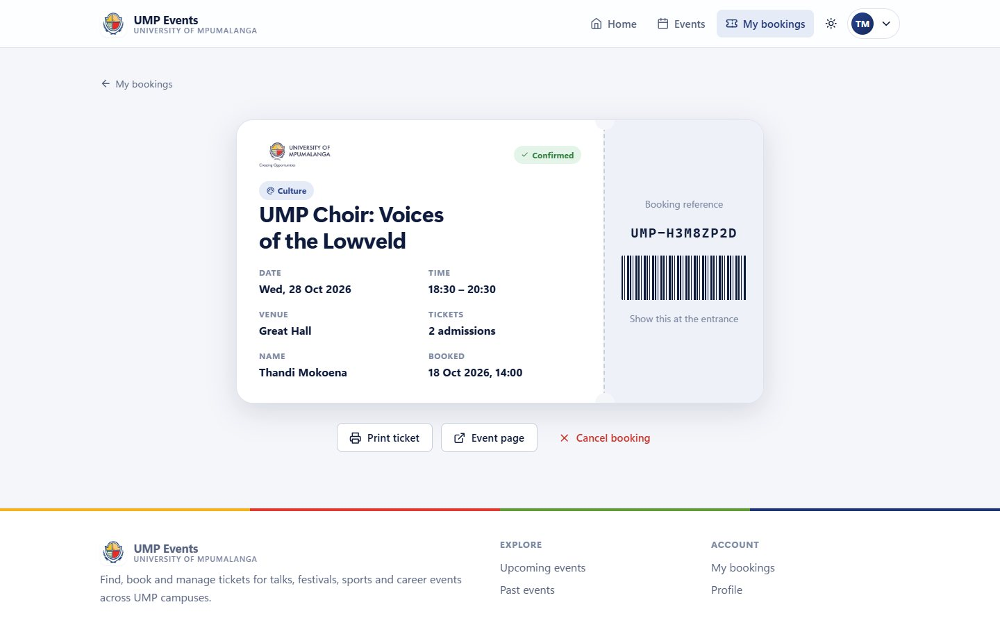
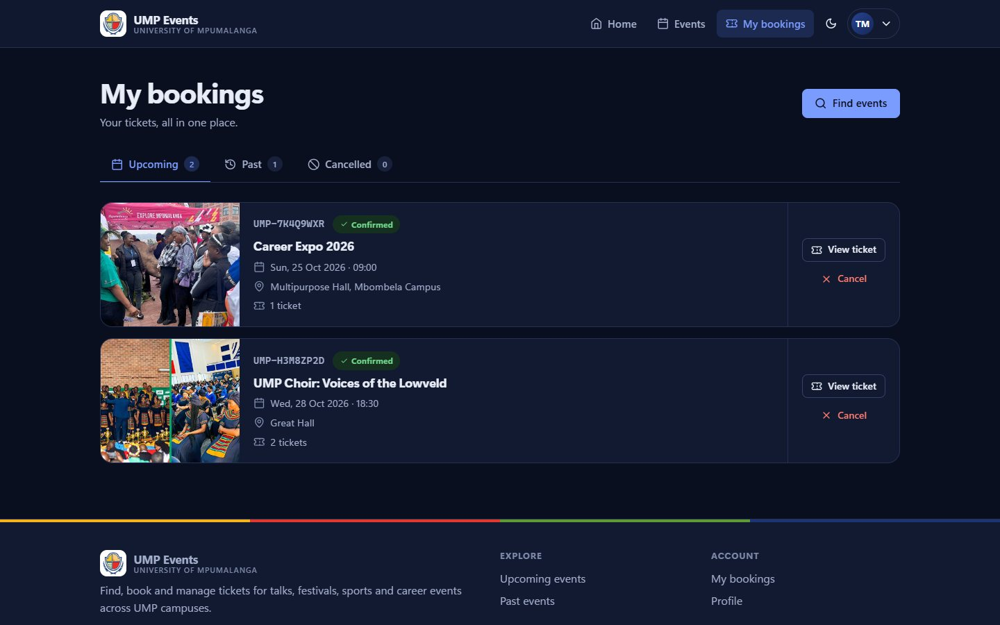
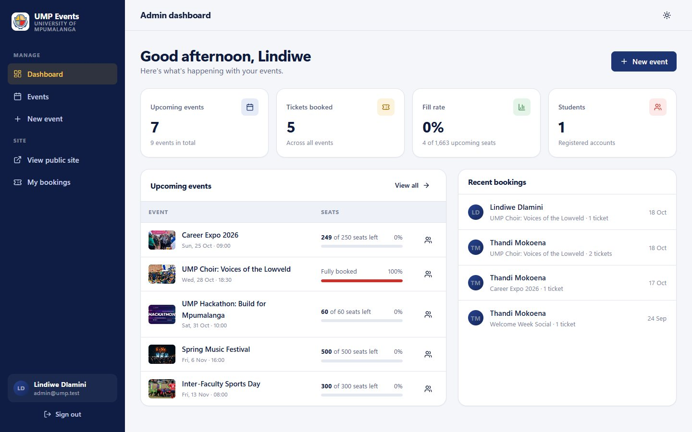
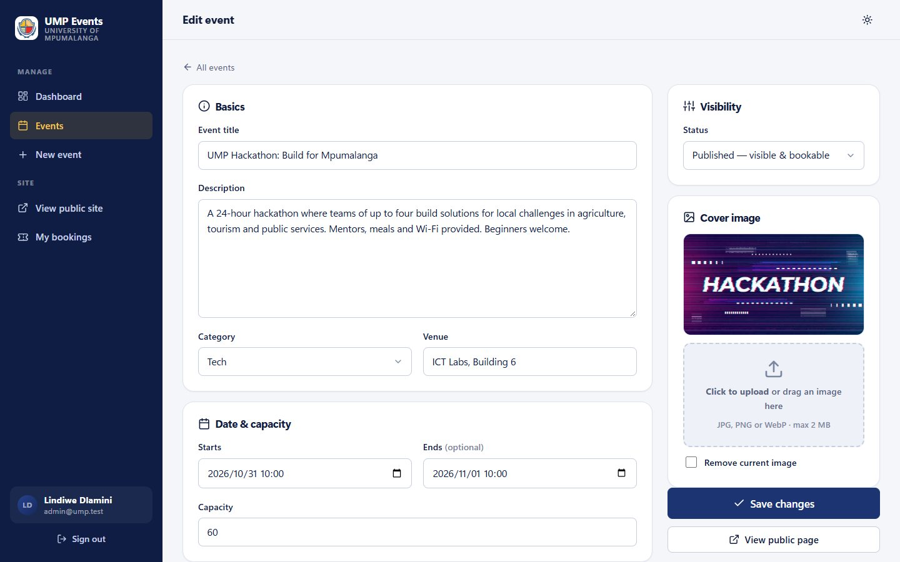

# UMP Event Booking

A campus event booking platform for the **University of Mpumalanga**. Students browse upcoming events, reserve seats and get a digital ticket. Administrators create and manage events, track attendance and export guest lists.

Built with **plain PHP 8.2 and MySQL/MariaDB**: no framework and no Composer. It uses a small MVC architecture I wrote from scratch, so every layer (routing, middleware, validation, data access) is visible and easy to follow.

> Originally a 2nd-year group project (procedural PHP pages). Rebuilt from the ground up with a proper architecture, a new UI and security hardening. See [What changed](#what-changed-from-the-original).



## Screenshots

| Browse events | Event details & booking |
|---|---|
|  |  |
| **Digital ticket** | **My bookings (dark mode)** |
|  |  |
| **Admin dashboard** | **Event editor** |
|  |  |

<p align="center"></p>

---

## Features

**Students**
- Browse upcoming and past events with search, category filters and pagination
- Live seat availability with "few seats left" and "sold out" states
- Book 1–4 tickets per event, with no overbooking and no duplicate bookings
- Digital ticket with a unique booking reference (printable)
- My bookings: upcoming, past and cancelled tabs; cancel any time before the event
- Profile and password management

**Administrators**
- Dashboard with upcoming events, tickets booked, fill rate and recent bookings
- Create, edit and delete events with cover-image upload, plus draft / published / cancelled status
- Attendee list per event, with CSV export

**Experience**
- Responsive from phones to desktops, with light and dark mode (follows the system setting, with a manual toggle)
- Accessible: semantic HTML, keyboard-friendly, visible focus, ARIA on forms and live regions, reduced-motion support
- Progressive enhancement: everything works without JavaScript; JS adds toasts, confirm dialogs, the quantity stepper, the password-strength meter and upload previews
- Custom inline SVG icon set; no external fonts, CDNs or trackers

## Tech stack

| Layer      | Choice |
|------------|--------|
| Language   | PHP 8.2 (strict types) |
| Database   | MySQL 8 / MariaDB 10.4+ via PDO |
| Front end  | Server-rendered PHP templates, hand-written CSS (design tokens), vanilla JS |
| Server     | Apache (XAMPP) or PHP's built-in server |

## Architecture

```
eventBookingWeb/
├── public/                  ← the ONLY web-accessible folder
│   ├── index.php            ← front controller (every request enters here)
│   ├── assets/              ← css, js, images
│   └── uploads/events/      ← admin uploads (PHP execution disabled)
├── app/
│   ├── Core/                ← mini framework: App, Router, Request, Response,
│   │                          Database, Session, Csrf, Auth, Validator, View, ErrorHandler
│   ├── Middleware/          ← auth, guest, admin, CSRF
│   ├── Controllers/         ← thin: read the request, call a service, return a view
│   ├── Services/            ← business rules (booking, auth, uploads, throttling)
│   ├── Repositories/        ← all SQL lives here, one class per table
│   └── Exceptions/
├── config/                  ← app + database settings (read from .env)
├── routes/web.php           ← every URL in one place
├── views/                   ← layouts, partials and pages
├── database/                ← schema.sql + seed.sql
├── bin/setup.php            ← creates the DB and loads demo data
├── docs/screenshots/        ← images used in this README
└── storage/logs/            ← error logs
```

**Request lifecycle**

```
Browser → public/index.php → bootstrap (env, config, error handler)
        → Router matches URL → middleware pipeline (csrf → auth → admin)
        → Controller → Service (rules) → Repository (SQL via PDO)
        → View rendered inside a layout → Response (+ security headers)
```

## Security

| Threat | Mitigation |
|---|---|
| SQL injection | PDO prepared statements everywhere, native prepares (`EMULATE_PREPARES=false`), LIKE wildcards escaped |
| XSS | All output escaped with `e()`; strict **Content-Security-Policy** (no inline scripts or styles) |
| CSRF | Per-session token checked on every POST (`hash_equals`); all state changes are POST-only |
| Session hijacking / fixation | `HttpOnly` + `SameSite=Lax` cookies, strict mode, ID regenerated on login/logout/password change, 2-hour idle timeout |
| Brute-force logins | Throttled to 5 failed attempts per email+IP per 15 minutes |
| User enumeration | Same error message and similar response time whether or not the email exists |
| Passwords | `password_hash()` (bcrypt), automatic rehash, minimum length plus letter and number rule |
| Malicious uploads | Size limit, MIME type sniffed from file bytes, `getimagesize` check, random filename, PHP execution disabled in `uploads/` |
| Broken access control | Route middleware for auth/admin; bookings always scoped to the owner (IDOR-safe) |
| Overbooking race conditions | Booking runs in a transaction with `SELECT … FOR UPDATE` on the event row; unique `(user_id, event_id)` constraint |
| Open redirects | Post-login redirects limited to internal paths |
| CSV / formula injection | Exported cells starting with `= + - @` are neutralised |
| Information leakage | Friendly error pages; stack traces only when `APP_DEBUG=true`; errors logged to `storage/logs`; `X-Powered-By` removed |
| Clickjacking & misc | `X-Frame-Options: DENY`, `nosniff`, `Referrer-Policy`, `Permissions-Policy`, HSTS on HTTPS |
| Secrets in code | DB credentials in `.env` (git-ignored); app code lives outside the web root |

## Getting started

### Requirements
- PHP 8.1+ with `pdo_mysql`, `mbstring` and `fileinfo` (all enabled in XAMPP)
- MySQL 8+ or MariaDB 10.4+ (XAMPP's MySQL works)

### 1. Configure
```bash
cp .env.example .env
```
The defaults match XAMPP (`root` with no password on `127.0.0.1:3306`). Edit `.env` if your setup differs.

### 2. Create the database
Either run the setup script:
```bash
php bin/setup.php
```
…or in **phpMyAdmin**, import `database/schema.sql` and then `database/seed.sql`.

> ⚠️ Setup drops and recreates the app's tables.

### 3. Run it

**Option A: PHP's built-in server (quickest)**
```bash
php -S localhost:8000 -t public public/index.php
```
Open http://localhost:8000

**Option B: XAMPP / Apache**
Copy or clone the project into `C:\xampp\htdocs\eventBookingWeb`, start Apache and MySQL, then open http://localhost/eventBookingWeb/. The root `.htaccess` forwards requests to `public/`. `mod_rewrite` must be enabled; it is by default in XAMPP.

### Demo accounts
| Role    | Email              | Password      |
|---------|--------------------|---------------|
| Admin   | `admin@ump.test`   | `Password123` |
| Student | `student@ump.test` | `Password123` |

Demo event dates are relative to the moment you seed, so there are always upcoming events. Re-run `php bin/setup.php` at any time to reset.

## Configuration

| Variable | Default | Purpose |
|---|---|---|
| `APP_ENV` | `development` | `production` hides the demo-account hint |
| `APP_DEBUG` | `false` | Show stack traces on 500 pages (never in production) |
| `APP_URL` | *(auto)* | Set only if base-URL auto-detection fails |
| `APP_TIMEZONE` | `Africa/Johannesburg` | |
| `DB_*` | XAMPP defaults | Database connection |

Booking limits, upload size, lockout policy and categories are in `config/app.php`.

## What changed from the original

| Before | After |
|---|---|
| 12 standalone PHP pages mixing HTML, SQL and logic | Layered MVC: router, middleware, controllers, services, repositories, views |
| Hard-coded DB credentials, `die()` with raw DB errors | `.env` config, a friendly 503 page, logged errors |
| No CSRF protection; events deleted via a GET link | CSRF tokens on every form; destructive actions POST-only with confirmation |
| Image upload accepted any file type (`.php` included) | Validated, renamed, non-executable uploads |
| Capacity stored but never enforced | Transactional booking with row locks, so overbooking is impossible |
| No session regeneration; "Email not found" vs "Invalid password" | Session fixation protection, generic errors, login throttling |
| Unstyled tables, inline styles, broken navbar markup | Design system with UMP crest colours, dark mode, responsive layouts |
| 19 MB of unoptimised images and unused videos | ~3 MB of resized, organised assets |
| Real user emails and password hashes in the committed SQL dump | Demo-only seed data |

## Credits
- Icons adapted from [Lucide](https://lucide.dev) (ISC licence)
- Photography and logo © University of Mpumalanga, used for this educational project
